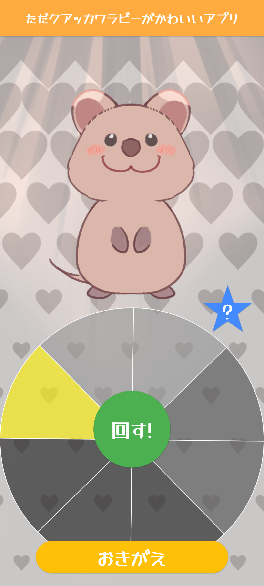
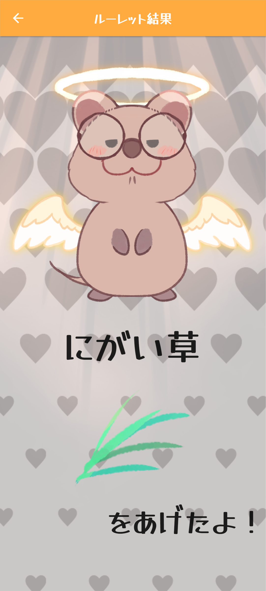
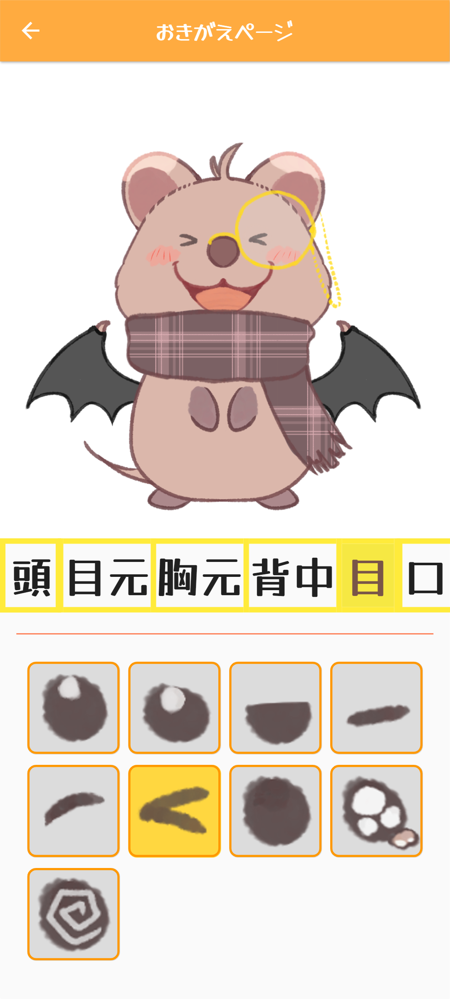

# アプリ概要 #
手描きクアッカワラビーの癒し系アプリです 
クアッカワラビーの着せ替えや食べ物抽選などができます 
※環境を整えれば動きはしますが、ほんとにコードがひどいです

## ホーム画面 ##
・「回す!」ボタンで食べ物抽選+ランダムで装飾がつきます 
・「おきがえ」ボタンで着せ替え画面へ 
・クアッカワラビー画像をタップするとちょっとしたアニメーションが出てきます(場所によって全3通り) 

    

 

## 抽選結果画面 ##
ホーム画面で「回す!」ボタンを押した時の遷移後の画面です 
食べ物抽選+ランダムで装飾がつきます 
装飾を含めない32通りのうち当たりは4通り、装飾も含めると全約40000通りです多分 

    

 

## 着せ替え画面 ##
ホーム画面で「おきがえ」ボタンを押した時の遷移後の画面です 
クアッカワラビーの着せ替えと表情変更ができます 
真ん中のバーで部位切り替えができます 

    

  

## 環境 ##
・**Flutter** 3.13.6 
・**OS** Windows10 
